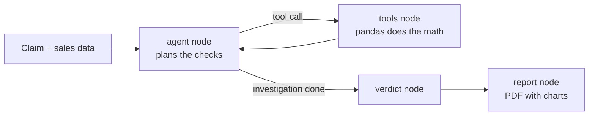

# Claim Falsifier

An AI agent that tests business claims by trying to **disprove** them.

Most "chat with your data" tools answer questions. This one takes a claim that someone already believes, such as *"Sales dropped in Q3 because we raised Category A prices on 2026-08-01"*, and checks whether the data can actually support it. It returns one of three verdicts: **supported**, **contradicted** or **inconclusive**, with the evidence behind it.

Businesses constantly act on stories that nobody verified. This agent turns a vague story into specific, testable predictions and runs them against the data.

## Example

```
CLAIM: Sales dropped in Q3 because we raised Category A prices on 2026-08-01.

  > find_changepoint {}
    {}: biggest shift starts 2026-07-01 (8978/day -> 7458/day, -16.9%)

  > breakdown_by category
    category=A: 2996/day -> 2476/day (-17.4%)
    category=B: 3009/day -> 2491/day (-17.2%)
    category=C: 2973/day -> 2491/day (-16.2%)

  > breakdown_by region
    region=Alexandria: 2985/day -> 2241/day (-24.9%)
    region=Cairo:      2995/day -> 2239/day (-25.2%)
    region=Giza:       2997/day -> 2978/day (-0.6%)

VERDICT: CONTRADICTED
  Sales fell across all categories starting before the price increase, and
  the drop is similar in categories A, B, and C. A control region (Giza)
  showed little change, suggesting other factors drove the decline.
```

*(abridged real output)* The drop started a month before the price change and hit every category equally, so the price increase cannot be the cause.

## How it works

The agent is a LangGraph graph with four nodes.



The **agent node** (an LLM) reads the claim and writes down what it predicts: when the change should start, which groups should be affected, and which should not. It then decides which tools to call and in what order. The **tools node** runs those tools, which are plain pandas functions, and returns the numbers. The loop repeats until the agent has enough evidence. The **verdict node** then receives only the claim and the raw tool results and produces a structured verdict. Finally, the **report node** turns the verdict, two charts and the full list of checks into a PDF.

The key design rule is that **the LLM never calculates a number**. Every figure comes from a pandas function, and the model only chooses which analysis to run and explains the results.

### Tools

| Tool | What it does |
|---|---|
| `describe_data` | Lists the columns, the date range, and the available categories and regions. |
| `find_changepoint` | Finds the date where daily revenue shifted most, by testing every split point. Used for the timing check: a cause must come before its effect. |
| `breakdown_by` | Compares average daily revenue between two periods for every category or every region in one call. Surfaces where a change is concentrated and which segments stayed flat (control groups). |
| `compare_periods` | Same comparison for one specific slice, for example Category A in Giza. |

### Grounding check

After the verdict is written, the code (not the model) scans every number in the summary, evidence and likely cause and checks that it appears in the tool results. If a number is missing, the verdict is regenerated once, and a warning is printed if the problem persists. This guards against the most common failure of LLMs on data: invented figures.

### Rate limits and retries

The agent runs on Groq's free tier, which limits tokens per minute. The verdict node sends only the claim and tool results rather than the full conversation, and the model client retries automatically on rate-limit errors.

## PDF report

Every run produces a PDF report. It opens with the claim and a colour-coded verdict, then gives the summary, the key evidence and the likely cause. Two charts follow: a timeline of total revenue marking the detected shift and the date the claim blames, and a bar chart of the change in every category and region, which makes it obvious which segments moved and which stayed flat. The last page lists every check the agent ran with its raw result, so a reader can trace each number back to its source, and ends with the outcome of the grounding check.

## Web app

`app.py` is a Streamlit interface. You pick or type a claim, press the button, and watch the agent call its tools live. The verdict, charts and a PDF download button appear when it finishes. The app runs on the synthetic demo dataset, so claims must be about its columns (date, category, region, revenue).

### Deploy for free

Push the repository to GitHub (the `.env` file is excluded by `.gitignore`, so the key is never uploaded). On share.streamlit.io choose the repository and set `app.py` as the main file. Under Advanced settings, Secrets, add:

```
GROQ_API_KEY = "your_key_here"
```

The free Groq tier limits tokens per minute for the whole key, so several visitors at once can trigger a rate-limit message. The app catches it and asks the visitor to retry.

## Testing with planted truths

The demo dataset is synthetic, so the correct answer is known. From 1 July, Cairo and Alexandria drop 25% across all categories, while the Category A price increase on 1 August has no effect at all. A correct run must say the claim is contradicted, find that the drop began before the price change, and show that Giza stayed flat.

A planted-truth evaluation matrix is in progress. Each dataset has a known correct verdict and is run several times, because LLM agents do not give identical answers every time.

| Scenario | Correct verdict | Pass rate |
|---|---|---|
| Price change truly causes the drop | supported | _to be added_ |
| Drop caused by a region, price change irrelevant (the demo) | contradicted | _to be added_ |
| Two overlapping causes | inconclusive or partial | _to be added_ |
| Data cannot answer the question | inconclusive | _to be added_ |

## Run it

Requires Python 3.10+ and a free Groq API key from console.groq.com.

```powershell
pip install -r requirements.txt
```

Create a file named `.env` next to `falsifier.py` containing one line (no quotes):

```
GROQ_API_KEY=your_key_here
```

Then run the agent in the terminal:

```powershell
python falsifier.py
```

This prints the investigation and saves `claim_report.pdf` next to the script. To use the web interface instead:

```powershell
streamlit run app.py
```

Model names on Groq change over time. If you get a "model not found" error, list the models available to your key, pick one that supports tool use, and change the `MODEL` constant at the top of `falsifier.py`.

## Limitations

The agent reports whether a claim survived the checks, not that it is proven: correlation in observational data is not causation. It currently works on one synthetic table with date, category, region and revenue columns. It checks timing and group differences but does not model price elasticity or other confounders it has no data for.

## Roadmap

Run the planted-truth evaluation matrix and publish the pass rates. Load a real uploaded Excel file with profiling and cleaning, so claims can be tested on the user's own data. Add a saved example run to the web app so it still works when the free-tier rate limit is hit.

## Stack

Python, pandas, numpy, LangGraph, LangChain, Groq (`openai/gpt-oss-120b`), pydantic, reportlab, matplotlib, Streamlit.
